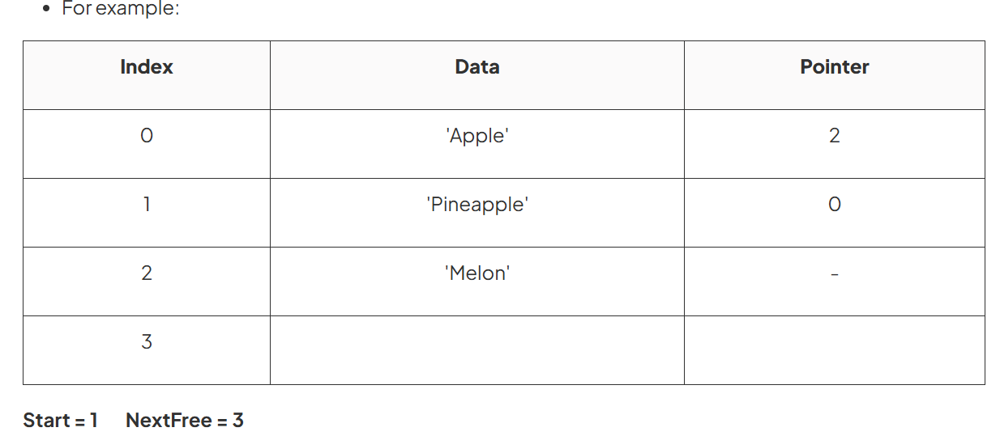

# Abstract Data Types
*A collection of data and a set of operations on the data*

---
## **Stacks**
### Basics 
- Last in, First out (FILO) 后来的data先被移除
  - PUSH: add item to top: Pointer increments by 1
  - POP: remove item from top: Pointer decrements by 1
- Two pointers (1 or more)
  - Base pointer: last item
  - Top pointer: first item
- Static data structure
  - stack overflow
  - stack underflow

### Pseudocodes
``` typescript
isEmpty() // returns bool
isFull() // returns bool
push(val)
pop()
peek() //returns value at the top of stack
size()
```
---
## **Queues**
### Basics
- First in, First out (FIFO) 先来的data先被移除
- stores data in order they arrive
  - ENQUEUE: Add data item at back of queue
  - DEQUEUE: Remove item from the front


### Linear Queue 线性队列
- Array
- 2 Pointers
    - Front Pointer: 1st data
    - Back Pointer: Last data
- ENQUEUE的时候检查queue是否满，DEQUEUE的时候检查queue是否空

### Circular Queue 循环队列
- static array
- 2 Pointers
  - Front Pointer: 1st data
  - Rear Pointer: adjust to next free position
- ENQUEUE的时候检查queue是否满，DEQUEUE的时候检查queue是否空

---

## **Linked List**
- chain of items (**nodes**), each contains:
  - data field
  - pointer to next node

### Disadvantages:
- Waste memory
  - 存数据+Pointer
  - Remove并不真正删除数据
- 只能按顺序遍历

### Traverse Linked List 遍历链表
- Check if empty
- 从Start Node开始
- 输出该node数据
- 跟随pointer到下个node并重复
- when null pointer --> 已到链表末端

### Adding Nodes
**Advantange:** easy add and remove by editing points

1. Check if there's free memory for data in
2. Add new value and adjust `NextFree` Pointer to 4
3. Make Pointer field of new value pointing to the next value

### Remove Nodes
1. Only need to modify the pointer to jump over this node
2. data isn't really deleted
   1. waste memory